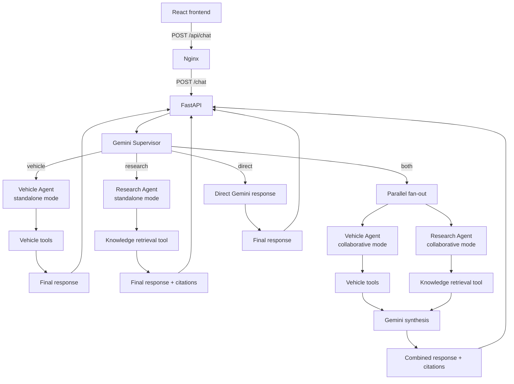

# EV Advisor

EV Advisor is a full-stack, multi-agent electric-vehicle assistant built for an Ericsson Agentic AI Full-Stack Developer take-home assignment. It helps users search and compare EV configurations, estimate charging costs, and understand topics such as charging, battery health, real-world range, and ownership.

The application combines curated vehicle specifications with a small, source-backed knowledge base. Gemini decides which specialist capability is appropriate, while LangGraph controls the allowed execution paths. Responses include citations where knowledge retrieval was used and an expandable trace of the agents and tools invoked.

## Capabilities

- Search a curated EV dataset by manufacturer, range, battery capacity, body type, and price.
- Compare exact vehicle configurations without inventing missing specifications.
- Estimate charging cost from energy, electricity price, currency, and charging efficiency.
- Answer general EV questions using local TF-IDF retrieval and citation-ready source metadata.
- Route dynamically to a Vehicle Agent, Research Agent, both specialists, or a direct conversational response.
- Retain short-term conversation context using a caller-visible conversation ID.
- Render Markdown answers, tables, links, citations, and agent/tool execution metadata in a responsive React interface.

## Technology stack

| Area | Technology |
| --- | --- |
| Frontend | React, TypeScript, Vite, `react-markdown`, `remark-gfm` |
| Frontend serving | Nginx with SPA fallback and `/api/` reverse proxy |
| Backend | Python, FastAPI, Pydantic, Uvicorn |
| LLM | Google Gemini through `langchain-google-genai`; default model `gemini-3.5-flash-lite` |
| Agent orchestration | LangGraph with an in-memory checkpointer |
| Retrieval | Local Markdown corpus, scikit-learn TF-IDF, cosine similarity |
| Vehicle data | Curated OpenEV Data v1.24.0 records |
| Local deployment | Docker Compose |

## Architecture



The Supervisor uses structured Gemini output to select one of four destinations. Routing is model-driven rather than based on keyword rules. Within each specialist, Gemini dynamically chooses from the tools available to that specialist.

LangGraph keeps the transitions deterministic after a route is selected:

- `vehicle` → Vehicle Agent → final response
- `research` → Research Agent → final response
- `both` → Vehicle and Research Agents in parallel → synthesis → final response
- `direct` → direct response

Single-specialist responses bypass synthesis. For a combined request, both specialists produce focused evidence concurrently, and synthesis waits for both before composing one answer. Tool loops are bounded to four model iterations. If either combined specialist fails, synthesis does not silently produce a partial answer.

### Agents and tools

- **Supervisor:** chooses `vehicle`, `research`, `both`, or `direct`, using recent conversation context to resolve follow-up references.
- **Vehicle Agent:** uses `search_vehicles`, `compare_vehicles`, and `calculate_charging_cost`. Comparisons require exact vehicle IDs returned by search.
- **Research Agent:** calls `search_ev_knowledge` before making factual general-EV claims and carries retrieved source URLs into the response.
- **Synthesis:** runs only for `both`; combines vehicle-specific evidence with general guidance without attributing unsupported features to a named vehicle.

Conversation state is stored in LangGraph's in-memory checkpointer under `conversation_id`. The frontend reuses the returned ID for follow-ups and clears it on **New Chat**. State is process-local and is lost when the backend restarts.

## Quick start with Docker

### Prerequisites

- Docker Desktop with WSL 2 on Windows, or Docker Engine with the Compose plugin
- A Google Gemini API key

From the repository root:

```powershell
Copy-Item .env.example .env
```

Edit `.env` and replace the placeholder:

```dotenv
GEMINI_API_KEY=your_api_key_here
GEMINI_MODEL=gemini-3.5-flash-lite
```

`GEMINI_MODEL` is optional; the value above is the backend default. Never put the API key in a `VITE_*` variable because Vite embeds those values in browser assets.

Build and start the application:

```powershell
docker compose up --build
```

Once both services are healthy:

- Frontend: <http://localhost:5173>
- Backend: <http://localhost:8000>
- OpenAPI documentation: <http://localhost:8000/docs>
- Health endpoint: <http://localhost:8000/health>

Stop and remove the containers and Compose network:

```powershell
docker compose down
```

Compose passes `.env` to the backend at runtime; it is not copied into either image. Nginx serves the frontend and rewrites `/api/chat` to `http://backend:8000/chat`. The project `data/` directory is mounted read-only at `/app/data`, avoiding duplication of the raw dataset in the backend image.

## Run locally without Docker

Use Python 3.12 and Node.js 22 to match the Docker images.

### Backend

From the repository root in PowerShell:

```powershell
py -3.12 -m venv .venv
.\.venv\Scripts\Activate.ps1
python -m pip install -r requirements.txt
Copy-Item .env.example .env
# Edit .env and provide GEMINI_API_KEY
python -m uvicorn backend.app.main:app --reload --env-file .env
```

### Frontend

In another terminal:

```powershell
Set-Location frontend
npm ci
npm run dev
```

Open <http://localhost:5173>. In local development the frontend defaults to `http://localhost:8000`; set `VITE_API_URL` before starting Vite only when a different backend URL is required.

To inspect frontend states without the backend, start the development-only preview from `frontend/`:

```powershell
$env:VITE_PREVIEW_MODE="true"
npm run dev
```

Open the URL printed by Vite and use the preview-scenario selector. Preview mode uses static fixtures and blocks chat requests. Its controls cannot activate in a production build because they also require Vite's development flag; the statically imported fixture module may still be present in the compiled JavaScript bundle.

## Example scenarios

Routing and tool selection are dynamic, so these examples demonstrate intended capabilities rather than guarantee a specific model decision or wording.

| Scenario | Example question | Capability demonstrated |
| --- | --- | --- |
| Vehicle search | “Find three Volvo EVs with at least 400 km rated range.” | Structured filtering while preserving the source range cycle |
| Vehicle comparison | “Compare the Volvo EX30 and Hyundai IONIQ 5.” | Search for exact configurations followed by structured comparison |
| Charging calculation | “What would it cost to charge a Tesla Model Y from 20% to 80% at €0.30/kWh?” | Vehicle lookup plus deterministic charging-cost calculation |
| EV knowledge | “Why does cold weather reduce EV range?” | Local knowledge retrieval with external source metadata |
| Combined evidence | “Compare the Volvo EX30 and Hyundai IONIQ 5 for winter highway driving.” | Vehicle specifications and general winter-range guidance, synthesized together when both are selected |
| Follow-up | “Which of those has faster DC charging?” | Conversation context resolved through the same `conversation_id` |

## Data and grounding

### Vehicle dataset

`data/raw/open-ev-data-v1.24.0.json` is the unchanged 1,189-record OpenEV Data v1.24.0 source. Its CDLA-Permissive-2.0 license is retained in `data/LICENSE-OPENEV-DATA.txt`.

`data/vehicles.json` is a deterministic 100-record selection:

| Manufacturer | Records | Distinct models |
| --- | ---: | ---: |
| Tesla | 18 | 5 |
| Volvo | 18 | 4 |
| BMW | 28 | 7 |
| Volkswagen | 20 | 5 |
| Hyundai | 16 | 4 |

The ingestion pipeline prioritizes distinct models, specification diversity, completeness, and recent model years, with stable identifier-based tie-breaking. It preserves original vehicle IDs and specification values. Regenerate the curated file with:

```powershell
.\.venv\Scripts\python.exe scripts\ingest_vehicles.py
```

Manufacturer limits and input/output paths are configurable; see:

```powershell
.\.venv\Scripts\python.exe scripts\ingest_vehicles.py --help
```

Important data limitations:

- Coverage is intentionally limited to five manufacturers and selected configurations.
- Range values retain their source cycles, such as WLTP or EPA, and should not be treated as interchangeable.
- Prices are sparse, market-specific source MSRP observations—not live offers or verified Swedish prices.
- No currency conversion is performed.
- Optional fields such as price or DC charging power may be missing and are not invented.
- Model names can represent multiple years, trims, or variants; exact configuration IDs matter for comparison.

### EV knowledge base

Five curated Markdown documents under `data/knowledge/` cover charging, battery health, real-world range, charging costs, and ownership. They were paraphrased from the US Department of Energy, Alternative Fuels Data Center, FuelEconomy.gov, NREL, and Geotab; each document records its source URLs and verification date.

`KnowledgeIndex` splits documents within section boundaries, builds a cached TF-IDF index over unigrams and bigrams, and ranks chunks with cosine similarity. Results below a minimum relevance score are omitted. Retrieval is deterministic and offline, but it is lexical rather than semantic and the small corpus cannot answer every EV question. Regional assumptions and source freshness still require care.

## API and frontend behavior

- `GET /health` returns `{"status":"ok"}`.
- `POST /chat` accepts a non-empty `message` and an optional URL-safe `conversation_id`.
- The response contains `reply`, `conversation_id`, `citations`, `agents_invoked`, and `tools_called`.

The execution fields expose observable agent and tool names only—not hidden reasoning, prompts, tool arguments, or timings. The frontend renders assistant Markdown safely, shows citations separately, and places execution metadata in an optional expandable summary. User messages remain plain text.

## Reliability, diagnostics, and testing

Each Gemini invocation has a 60-second request timeout. The workflow retries only `TimeoutError` and provider statuses `429`, `500`, `502`, `503`, and `504`, with exponential backoff and at most two retries per individual invocation. Because one user request can contain several Gemini invocations, its total retry count can exceed two. Other validation, parsing, schema, and application errors are not retried automatically.

FastAPI returns a sanitized `503` for retryable provider failures, `504` for provider timeouts, and `500` for unexpected generation failures. Nginx waits up to 180 seconds for a backend response before returning its own `504`. Exceptionally slow multi-call workflows can still exceed that proxy timeout.

The backend writes sanitized `workflow_diagnostics` JSON logs containing model-attempt durations, retry metadata, agent-stage durations, and tool durations. Logs intentionally exclude API keys, prompts, full conversations, tool arguments/results, and conversation IDs:

```powershell
docker compose logs backend
```

Run the offline backend suite:

```powershell
.\.venv\Scripts\python.exe -m pytest
```

The tests cover ingestion, deterministic vehicle tools, retrieval, API behavior, routing, parallel state merging, citations, conversation isolation, retries, and failure handling. Gemini behavior is replaced with deterministic test doubles; the suite does not require a live API call.

Run the frontend unit tests, explicit type check, and production build:

```powershell
Set-Location frontend
npm ci
npm test
npx tsc -b
npm run build
```

The frontend tests use static fixtures and Node's built-in test runner. `npm run build` also runs TypeScript compilation before the Vite production build.

## Troubleshooting

- **Backend reports `GEMINI_API_KEY` is missing:** confirm `.env` exists at the repository root and contains a non-placeholder key; then recreate the backend container.
- **Port 5173 or 8000 is already in use:** stop the conflicting local process or the existing Compose stack. For a second Vite instance, use `npm run dev -- --port=5174`.
- **Frontend receives 503:** inspect sanitized backend diagnostics; Gemini may have exhausted its bounded retries or be temporarily unavailable.
- **Frontend receives 500:** an unexpected generation failure occurred; inspect the sanitized backend diagnostics.
- **Frontend receives 504:** Nginx did not receive a backend response within 180 seconds. The backend may still log a separate Gemini provider timeout or completion event.
- **Containers do not become healthy:** run `docker compose ps` and `docker compose logs backend frontend`.
- **Dependencies appear stale:** run `docker compose build --no-cache`, followed by `docker compose up`.
- **Local Vite cannot reach FastAPI:** verify <http://localhost:8000/health> and use port 5173, which is allowed by the current backend CORS configuration.

## Repository structure

```text
backend/app/agents/     LangGraph workflow, prompts, and LangChain tool adapters
backend/app/rag/        Local TF-IDF retrieval
backend/app/vehicles/   Dataset models, ingestion, repository, and deterministic tools
backend/tests/          Offline backend test suite
data/knowledge/         Curated, source-backed EV knowledge documents
data/raw/               Original OpenEV Data source
frontend/src/           React chat interface and Markdown rendering
scripts/                Dataset ingestion entry point
compose.yaml            Backend/frontend services and health checks
```

## Limitations and future improvements

- Gemini availability and latency vary; multi-step requests can be slow even with parallel specialists and bounded retries.
- Vehicle coverage is limited to 100 curated records from five manufacturers, not a live market inventory.
- The knowledge corpus is small, static, and lexically retrieved; it is not a substitute for current manufacturer, charging-network, or regulatory information.
- Conversation memory is in-process and disappears on restart; it is unsuitable for multiple backend workers without shared persistence.
- Vehicle prices and availability are incomplete and can become outdated.
- The API returns complete responses rather than streaming partial output.

Reasonable next steps include streamed responses, persistent session storage, a broader and periodically refreshed dataset, expanded retrieval with evaluation, and deployment-oriented observability and access controls.
