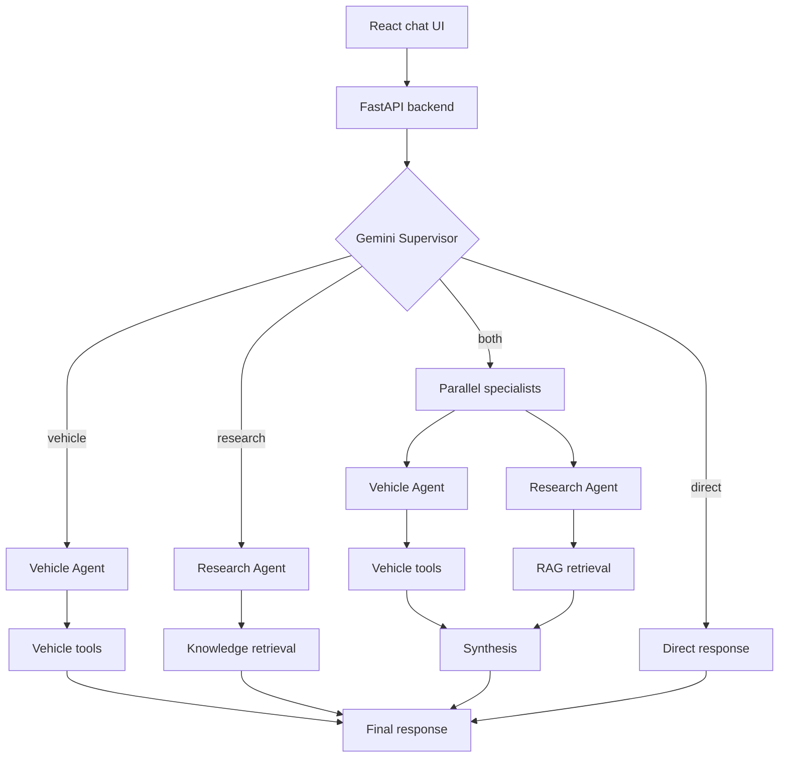

# EV Advisor

EV Advisor is a full-stack, multi-agent electric-vehicle assistant built for the Ericsson Agentic AI Full-Stack Developer take-home assignment. Users can search and compare EV configurations, estimate charging costs, ask about EV ownership and technology, and combine structured vehicle specifications with retrieved EV knowledge.

## Setup

Prerequisites:

- Git
- A Google Gemini API key
- Docker Desktop (quick start)
- Python 3.12 and Node.js 22 (manual setup)

Clone the repository and enter the project directory:

```powershell
git clone https://github.com/Edit-3D/ev-advisor.git
cd ev-advisor
```

Create the local environment file:

```powershell
Copy-Item .env.example .env
```

Add your key to `.env`. The model is optional because the shown value is the backend default:

```dotenv
GEMINI_API_KEY=your_api_key_here
GEMINI_MODEL=gemini-3.5-flash-lite
```

### Quick Start with Docker

Build and start both services:

```powershell
docker compose up --build
```

Stop the services and remove the Compose network with:

```powershell
docker compose down
```

### Manual Setup without Docker

The manual setup commands below use Windows PowerShell. Docker is recommended for cross-platform setup.

From the repository root, create the Python environment and install dependencies:

```powershell
py -3.12 -m venv .venv
.\.venv\Scripts\Activate.ps1
python -m pip install -r requirements.txt
```

Start FastAPI:

```powershell
python -m uvicorn backend.app.main:app --reload --env-file .env
```

In a second terminal, install frontend dependencies:

```powershell
cd frontend
npm ci
```

Start Vite:

```powershell
npm run dev
```

With either setup, use:

- Frontend: <http://localhost:5173>
- API documentation: <http://localhost:8000/docs>
- Health endpoint: <http://localhost:8000/health>


## Technology Stack

| Area | Technology |
| --- | --- |
| Frontend | React, TypeScript, Vite, `react-markdown`, `remark-gfm` |
| Backend | Python, FastAPI, Pydantic, Uvicorn |
| LLM | Google Gemini; default `gemini-3.5-flash-lite` |
| Agent orchestration | LangGraph with an in-memory checkpointer |
| RAG | Markdown documents, scikit-learn TF-IDF, cosine similarity |
| Vehicle data | Curated OpenEV Data v1.24.0 dataset |
| Runtime | Docker Compose and Nginx |

## Architecture



Gemini dynamically selects a route and, within each specialist, which available tools to call. LangGraph constrains those model-driven decisions to defined execution paths, manages parallel work, and returns one final response.

## Agents and Responsibilities

**Supervisor** interprets the request and recent conversation context, then selects the Vehicle Agent, Research Agent, both specialists, or a direct conversational response.

**Vehicle Agent** handles structured specifications, searches, exact-configuration comparisons, and charging-cost calculations. Numerical facts come from deterministic tools instead of being invented by the LLM.

**Research Agent** handles general questions about charging, batteries, range, and EV ownership. It retrieves relevant passages from the local knowledge base before answering factual research questions.

**Synthesis** runs only when both specialists are selected. It combines their evidence into one response without attributing general guidance to a specific vehicle unless the structured data supports it.

LangGraph coordinates execution based on Gemini's routing decisions. When both agents are selected, they run in parallel before synthesis. Otherwise, the selected agent responds directly. Conversation context is maintained in memory using a conversation_id and is lost when the backend restarts.

## Tools and RAG

1. `search_vehicles` searches and filters the curated vehicle dataset.
2. `compare_vehicles` compares exact vehicle configurations by their identifiers.
3. `calculate_charging_cost` performs a deterministic charging-cost calculation.
4. `search_ev_knowledge` retrieves relevant knowledge-base passages.

RAG uses five curated Markdown documents, split into chunks and searched using TF-IDF and cosine similarity. Retrieved passages provide context for the Research Agent. The Sources panel displays deduplicated external references associated with those passages.

## Example Questions

Actual routing depends on Gemini's decision, so these examples demonstrate capabilities rather than guarantee a particular execution trace.

| Capability | Example |
| --- | --- |
| Vehicle search | “Find electric SUVs with at least 400 km of range.” |
| Vehicle comparison | “Compare the Volvo EX30 and Hyundai IONIQ 5.” |
| Charging calculation | “What does it cost to charge a Volvo EX30 from 20% to 80% at 3 SEK/kWh?” |
| RAG knowledge | “Why does cold weather reduce EV range?” |
| Multi-agent collaboration | “Compare the Volvo EX30 and Hyundai IONIQ 5 for winter driving in Sweden. Include range, charging speeds, and cold-weather effects.” |

The final example benefits from structured vehicle specifications and retrieved cold-weather guidance, which the two specialists can supply together.

## Testing

With the manual setup's Python environment activated and dependencies installed, run the backend suite from the repository root:

```powershell
python -m pytest
```

Run the frontend tests, type check, and production build:

```powershell
cd frontend
npm ci
npm test
npx tsc -b
npm run build
```

Automated tests use deterministic substitutes and do not require live Gemini API calls.

## Future Improvements

Given more development time, I would focus on the following improvements:

- **Semantic Search for RAG:** Replace or complement the current TF-IDF retrieval with embedding-based semantic search. TF-IDF relies primarily on keyword overlap, which can cause relevant information to be missed when users phrase questions differently from the knowledge-base documents. Semantic search would improve retrieval by identifying passages based on meaning rather than exact wording.

- **Agent Routing and Context Handling:** Improve the Supervisor's ability to interpret ambiguous requests and follow-up questions using conversation history. Although the current system supports contextual interactions, routing decisions are model-driven and can sometimes be inconsistent. More robust routing evaluation and context handling would help ensure requests reach the appropriate agents and tools.

- **Expanded Tools and Data Integration:** Integrate live vehicle-data sources to provide more current specifications, pricing, and availability instead of relying solely on a static dataset. Additional tools could support personalized vehicle recommendations based on budget, driving habits, and charging preferences, or estimate journey charging requirements using route distance and vehicle range.

- **Agent Evaluation and Testing:** Develop a more comprehensive evaluation framework to measure tool-selection accuracy, retrieval relevance, and response consistency across repeated queries. While the current implementation includes automated tests, evaluating complete multi-agent interactions would help identify issues that individual component tests might miss.
